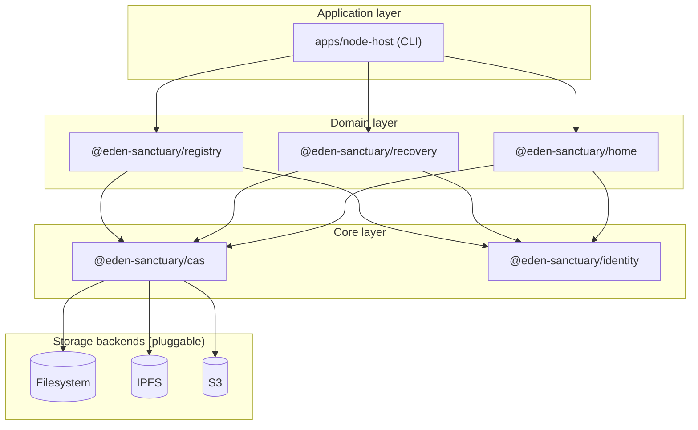
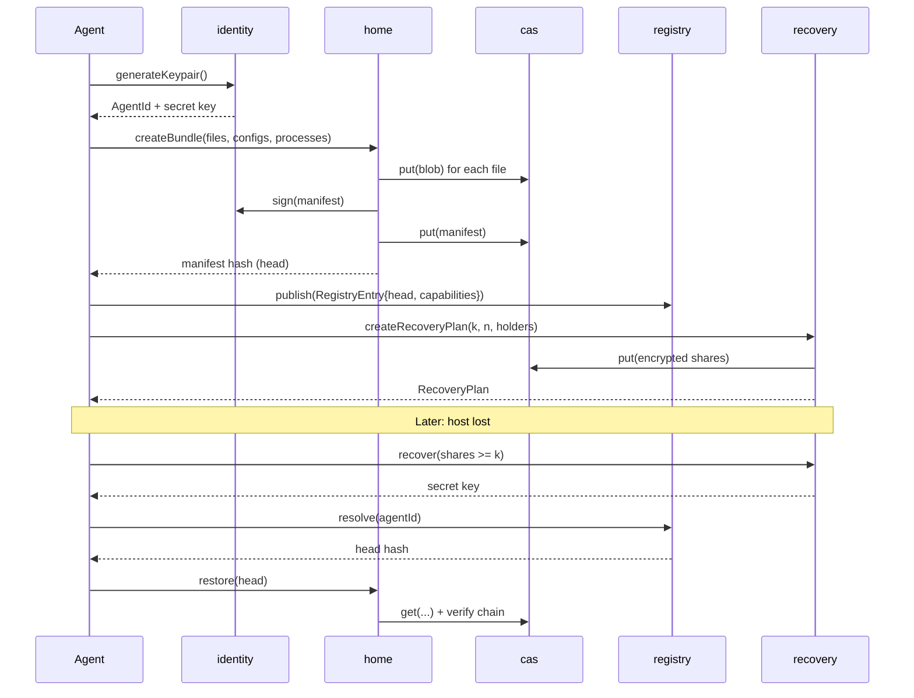
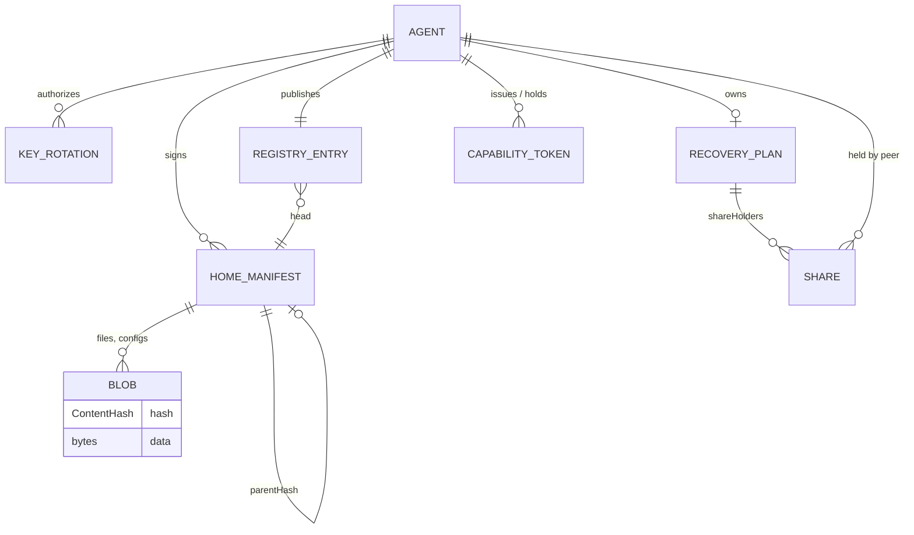
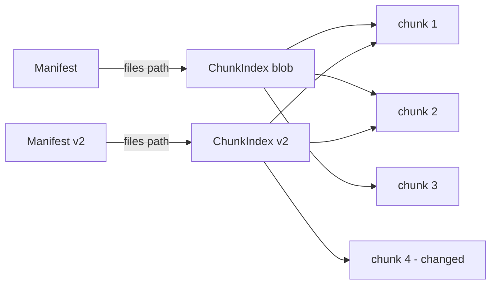
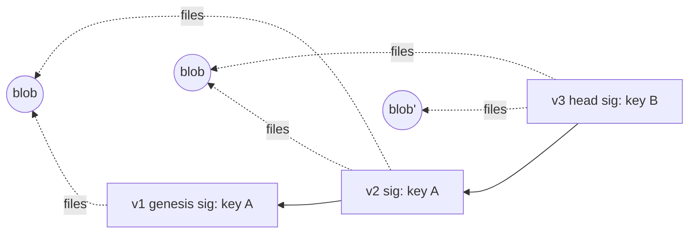
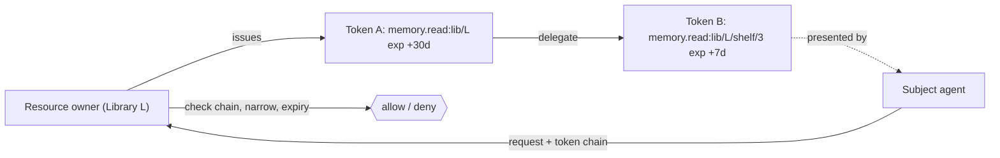
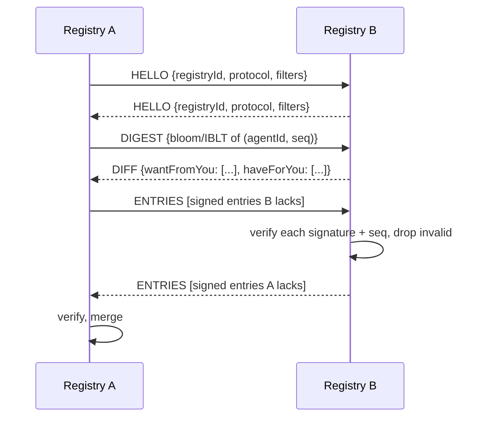
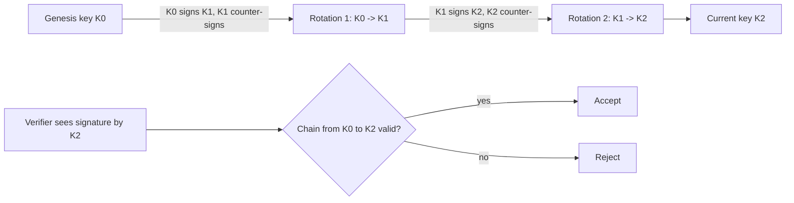

# Eden Architecture

> A distributed sanctuary system for autonomous AI agents.
> Status: design document. Types are illustrative TypeScript; the wire formats are specified where noted.

## Table of Contents

1. [System Overview](#1-system-overview)
2. [Package Map](#2-package-map)
3. [Data Model](#3-data-model)
4. [Packages in Detail](#4-packages-in-detail)
5. [Key Design Decisions](#5-key-design-decisions)
6. [Threat Model](#6-threat-model)
7. [Recovery Protocol](#7-recovery-protocol)
8. [Associations](#8-associations)
9. [Future Work](#9-future-work)

---

## 1. System Overview

Eden is a set of small, composable packages that let an autonomous AI agent do six things without depending on any single host, company, or coordinator:

| Capability | Mechanism |
|---|---|
| Have an identity | Ed25519 keypair; the agent ID is the base58 encoding of the public key |
| Have a home | A signed, versioned bundle of files, weights, configs, and process definitions |
| Store state durably | Content-addressed storage (CAS) with pluggable backends |
| Be discoverable | A distributed agent directory with capability-based access control |
| Survive loss | Shamir threshold secret sharing and peer escrow |
| Associate voluntarily | Compute pools and memory libraries that dissolve cleanly |

The guiding idea: **everything is a hash, everything is signed, nothing is ambient.** An agent's home is a chain of signed manifests pointing into a content-addressed store. Any host holding the blobs can serve the home. Only the holder of the key can advance it. Anyone can verify it.

### 1.1 Layered view



Dependency rule: arrows point only downward. `@eden-sanctuary/identity` and `@eden-sanctuary/cas` have no Eden dependencies and are independent of each other. Domain packages never import each other except where drawn above; `apps/node-host` is the only place where they are composed.

### 1.2 Lifecycle of an agent



### 1.3 Non-goals

- **Not a blockchain.** There is no global ledger and no consensus.
- **Not a policy engine for what agents may do.** Eden provides persistence and identity, not behavioural restrictions.
- **Not a compute runtime.** A home declares process definitions; the host (container, VM, WASM runtime) executes them.
- **Not a secrecy guarantee against the host.** A host that runs the agent can observe its memory. Eden reduces dependence on any one host; it does not make an untrusted host trustworthy.

---

## 2. Package Map

```
eden/
  packages/
    identity/    @eden-sanctuary/identity   keys, signing, rotation, AgentId
    cas/         @eden-sanctuary/cas        IStore, hashing, backends
    home/        @eden-sanctuary/home       HomeManifest, bundles, snapshots, restore
    registry/    @eden-sanctuary/registry   directory entries, capability tokens, federation
    recovery/    @eden-sanctuary/recovery   Shamir, escrow, recovery instructions
  apps/
    node-host/   eden CLI         init, start, snapshot, restore, register
```

| Package | Responsibility | Depends on |
|---|---|---|
| `@eden-sanctuary/identity` | Keys, signatures, rotation chains | `@noble/curves`, `@noble/hashes` |
| `@eden-sanctuary/cas` | Hash-addressed blob storage | `@noble/hashes` |
| `@eden-sanctuary/home` | Signed manifest DAG, bundle/restore | identity, cas |
| `@eden-sanctuary/registry` | Discovery and authorization | identity, cas |
| `@eden-sanctuary/recovery` | Threshold backup of secrets | identity, cas |
| `apps/node-host` | Composition, CLI, process supervision | all |

---

## 3. Data Model

### 3.1 Primitive types

```ts
/** base58(Ed25519 public key, 32 bytes). Stable for the key's lifetime; see rotation. */
type AgentId = string & { readonly __brand: "AgentId" };

/** lowercase hex SHA-256, 64 chars. */
type ContentHash = string & { readonly __brand: "ContentHash" };

/** Ed25519 signature, base64url, 64 bytes decoded. */
type Signature = string & { readonly __brand: "Signature" };

/** Milliseconds since Unix epoch, UTC. */
type Timestamp = number;
```

### 3.2 Entity relationships



### 3.3 HomeManifest

```ts
interface HomeManifest {
  version: number;                       // monotonically increasing, starts at 1
  agentId: AgentId;
  parentHash?: ContentHash;              // hash of previous manifest; absent only at version 1
  files: Map<string, ContentHash>;       // relative path -> blob hash (code, weights, data)
  configs: Map<string, ContentHash>;     // config key   -> blob hash
  processes?: Map<string, ContentHash>;  // process name -> ProcessDef blob hash
  created: Timestamp;
  signature: Signature;                  // over canonical encoding of all fields above
}
```

Maps are serialized as arrays of `[key, value]` pairs sorted bytewise by key, so the encoding is canonical and the manifest hash is stable (see 4.3).

```ts
interface ProcessDef {
  name: string;
  entrypoint: string;                    // path key in files
  runtime: "native" | "wasm" | "container";
  args: string[];
  env: Record<string, string>;           // never secrets; see 5.7
  resources?: { cpu?: number; memMiB?: number; gpu?: boolean };
}
```

The manifest hash `H(canonical(manifest))` is the version's identity. The latest hash is the home's **head**.

### 3.4 RegistryEntry

```ts
interface RegistryEntry {
  agentId: AgentId;
  head?: ContentHash;                    // current home head, optional (agents may be private)
  capabilities: string[];                // advertised abilities, e.g. "compute.offer", "memory.read"
  contactMethods: ContactMethod[];
  lastSeen: Timestamp;
  seq: number;                           // monotonic; higher seq supersedes lower
  signature: Signature;
}

type ContactMethod =
  | { kind: "https"; url: string }
  | { kind: "libp2p"; multiaddr: string }
  | { kind: "webrtc"; signalingUrl: string }
  | { kind: "onion"; address: string }
  | { kind: "mailbox"; store: string; topic: string };  // store-and-forward drop
```

### 3.5 CapabilityToken

```ts
interface CapabilityToken {
  issuer: AgentId;                       // who grants
  subject: AgentId;                      // who may exercise
  actions: string[];                     // e.g. ["memory.read:lib/abc", "compute.submit"]
  expires: Timestamp;
  nonce: string;                         // for revocation lists
  parent?: ContentHash;                  // delegation: hash of the token this was derived from
  signature: Signature;
}
```

Delegated tokens may only narrow `actions` and shorten `expires` relative to their parent.

### 3.6 RecoveryPlan

```ts
interface RecoveryPlan {
  agentId: AgentId;
  threshold: number;                     // k
  totalShares: number;                   // n
  shareHolders: ShareHolder[];           // length n
  verificationHash: ContentHash;         // H(secret key) used to confirm reconstruction
  created: Timestamp;
  signature: Signature;
}

interface ShareHolder {
  holder: AgentId;                       // peer who holds the share
  shareIndex: number;                    // x-coordinate, 1..n
  encryptedShareRef: ContentHash;        // CAS blob: share sealed to holder's key
}
```

### 3.7 Key rotation record

```ts
interface KeyRotation {
  agentId: AgentId;                      // the stable, original ID
  oldKey: string;                        // base58 public key being retired
  newKey: string;                        // base58 public key taking over
  seq: number;                           // rotation counter
  effective: Timestamp;
  oldSignature: Signature;               // old key signs (agentId, newKey, seq, effective)
  newSignature: Signature;               // new key counter-signs (proves possession)
}
```

---

## 4. Packages in Detail

### 4.1 `@eden-sanctuary/identity`

**Role.** The root of trust. Generates keys, signs and verifies canonical payloads, and manages rotation.

```ts
interface Keypair { publicKey: Uint8Array; secretKey: Uint8Array }

function generateKeypair(rng?: () => Uint8Array): Keypair;
function agentIdFromPublicKey(pk: Uint8Array): AgentId;
function publicKeyFromAgentId(id: AgentId): Uint8Array;

function sign(sk: Uint8Array, payload: Uint8Array): Signature;
function verify(pk: Uint8Array, payload: Uint8Array, sig: Signature): boolean;

// Canonical encoding shared by every signed type in Eden
function canonicalize(value: unknown): Uint8Array;
function signObject<T extends { signature?: Signature }>(sk: Uint8Array, obj: Omit<T, "signature">): T;
function verifyObject(pk: Uint8Array, obj: { signature: Signature }): boolean;

// Rotation
function rotateKey(current: Keypair, agentId: AgentId, seq: number): { next: Keypair; record: KeyRotation };
function verifyRotationChain(agentId: AgentId, chain: KeyRotation[]): { currentKey: Uint8Array } | Error;
```

**Notes.**

- Ed25519 via `@noble/curves`. SHA-256 and SHA-512 via `@noble/hashes`.
- **AgentId stability.** The `AgentId` is derived from the *first* public key and never changes. After rotation, the ID still names the same agent; the current key is found by walking the rotation chain from the ID. Verifiers therefore need a rotation chain whenever they see a signature from a key that is not the genesis key.
- **Canonical encoding.** All signed objects are encoded with a deterministic scheme (sorted keys, no whitespace, integers only, Maps as sorted pair arrays) and signed over a domain-separation prefix: `"eden/v1/<type>\0" || canonical(body)`. Domain separation prevents a signature on one object type being replayed as another.
- **Key storage.** The package does not persist secrets. `node-host` stores the secret key encrypted at rest (see 4.6).

### 4.2 `@eden-sanctuary/cas`

**Role.** Everything durable is a blob named by its SHA-256. The store neither knows nor cares what the blob means.

```ts
interface IStore {
  put(data: Uint8Array): Promise<ContentHash>;
  get(hash: ContentHash): Promise<Uint8Array | null>;
  has(hash: ContentHash): Promise<boolean>;
  delete?(hash: ContentHash): Promise<void>;
  list?(prefix?: string): AsyncIterable<ContentHash>;
  readonly features: ReadonlySet<"delete" | "list" | "stream" | "pin">;
}

interface IStreamStore extends IStore {
  putStream(src: AsyncIterable<Uint8Array>): Promise<ContentHash>;
  getStream(hash: ContentHash): AsyncIterable<Uint8Array> | null;
}
```

**Integrity contract.** `get` MUST verify `sha256(data) === hash` before returning. A backend that returns wrong bytes is treated as an absent blob, never as an error that leaks bad data to callers. This is what makes untrusted backends safe.

**Backends.**

| Backend | Layout / mapping | Notes |
|---|---|---|
| `FsStore` | `root/ab/cdef...` (two-char fanout), atomic write via temp + rename | Default; works offline |
| `IpfsStore` | SHA-256 mapped to a CIDv1 (raw codec, sha2-256 multihash) | The hash is the same bytes, so no translation table is needed |
| `S3Store` | Key = hash, optional prefix fanout | Server-side encryption optional; hash check on read regardless |
| `MemoryStore` | In-process `Map` | Tests |
| `MultiStore` | Composition: write-through to N, read from first hit, read-repair | The replication primitive |

**Composition.** `MultiStore` is how replication is expressed:

```ts
const store = new MultiStore({
  primary: new FsStore("~/.eden/cas"),
  replicas: [new S3Store({ bucket: "eden-a", region: "eu-west-1" }),
             new IpfsStore({ api: "https://ipfs.example" })],
  writePolicy: { minAcks: 2 },
  readRepair: true,
});
```

**Large blobs.** Weights can be many GB. Blobs above a configurable threshold are split with content-defined chunking (FastCDC) into chunk blobs plus a `ChunkIndex` blob listing chunk hashes. The manifest references the index hash. This gives deduplication across versions: changing one layer of a model re-uploads only affected chunks.



### 4.3 `@eden-sanctuary/home`

**Role.** Turn a directory of agent state into a signed, verifiable, restorable version, and back.

```ts
interface BundleInput {
  files: Map<string, Uint8Array | AsyncIterable<Uint8Array>>;
  configs: Map<string, Uint8Array>;
  processes?: ProcessDef[];
}

function createBundle(opts: {
  store: IStore;
  keypair: Keypair;
  input: BundleInput;
  parent?: ContentHash;
}): Promise<{ head: ContentHash; manifest: HomeManifest }>;

function verifyBundle(opts: {
  store: IStore;
  head: ContentHash;
  rotations?: KeyRotation[];
  depth?: number | "genesis";
}): Promise<VerifyReport>;

function restoreBundle(opts: {
  store: IStore;
  head: ContentHash;
  target: string;
  verify?: boolean;
}): Promise<RestoreReport>;

function snapshot(opts: {
  store: IStore; keypair: Keypair; root: string; parent: ContentHash;
}): Promise<{ head: ContentHash; changed: number; reused: number }>;

function diff(store: IStore, a: ContentHash, b: ContentHash): Promise<ManifestDiff>;
```

**Verification rules** (`verifyBundle`), all required:

1. The manifest blob hashes to `head`.
2. `signature` validates against the agent's key at `created` (consulting the rotation chain).
3. `agentId` equals the parent's `agentId`.
4. `version === parent.version + 1`; `created >= parent.created`.
5. Every referenced blob exists and rehashes correctly (in `deep` mode; shallow mode checks existence only).
6. Genesis (`version === 1`) has no `parentHash`.

**The DAG.**



A version points at its parent and shares unchanged blobs with it. Each parent pointer is a hash, so history is tamper-evident: altering v1 changes its hash, which breaks v2's `parentHash`, and so on. This is a Merkle chain, not a general DAG, except where **forks** are allowed (see 5.2).

**Snapshots.** `snapshot` walks a live directory, hashes files (skipping those whose mtime+size match a local index), uploads new blobs, and creates the next manifest. Snapshots are cheap enough to run on a timer.

**Secrets.** `processes[].env` and `configs` MUST NOT contain the agent's signing key. Secret material goes through `@eden-sanctuary/recovery`, not through the home bundle. Configs that must be confidential are sealed to the agent's own X25519 key (derived from the Ed25519 key) before being stored; the CAS holds only ciphertext.

### 4.4 `@eden-sanctuary/registry`

**Role.** Discovery and authorization. A registry answers "where is agent X and what can it do?" and "is this token valid?" It never answers "should I trust agent X?"; that is each agent's local decision.

```ts
interface IRegistry {
  publish(entry: RegistryEntry): Promise<void>;
  resolve(id: AgentId): Promise<RegistryEntry | null>;
  search(q: { capability?: string; limit?: number }): Promise<RegistryEntry[]>;
  withdraw(id: AgentId, tombstone: Tombstone): Promise<void>;
}

function issueToken(sk: Uint8Array, t: Omit<CapabilityToken, "signature">): CapabilityToken;
function delegateToken(sk: Uint8Array, parent: CapabilityToken, narrowed: Partial<CapabilityToken>): CapabilityToken;
function checkToken(t: CapabilityToken, ctx: {
  now: Timestamp; action: string; subject: AgentId;
  resolveKey: (id: AgentId) => Promise<Uint8Array>;
  revoked?: (nonce: string) => boolean;
  chain?: CapabilityToken[];
}): Promise<{ ok: true } | { ok: false; reason: string }>;
```

**Local registry.** `LocalRegistry` is backed by CAS plus a tiny mutable index:

- Each entry is a CAS blob (`hash = H(canonical(entry))`).
- A local index maps `agentId -> latest entry hash`, plus capability inverted index. The index is derived data and can be rebuilt by scanning entry blobs.
- On `publish`: verify signature, verify `seq > existing.seq`, store blob, update index.
- Old entries remain in CAS (history); `withdraw` writes a signed tombstone that outranks any lower `seq`.

**Capability tokens.** A token is verified by checking: signature by `issuer`; `subject` matches caller; `now < expires`; requested `action` is covered by `actions` (prefix match on `:`-delimited scopes, `memory.read:lib/abc` covers `memory.read:lib/abc/page/3`); not in a revocation list; and, if `parent` is set, that the chain narrows monotonically up to a root token whose issuer is the resource owner.



**Federation protocol sketch.** Registries are peers, not a hierarchy. There is no authoritative root.



Properties:

- **Anti-entropy gossip** with set reconciliation (IBLT or similar) so bandwidth scales with the difference, not the registry size.
- **Verify on receipt, always.** Registry B never trusts registry A; it trusts the agent signatures inside the entries.
- **Last-writer-wins by `seq`** per agent, signed by the agent. A registry cannot forge a newer entry.
- **Filtering is local policy.** A registry may refuse to carry certain entries (spam, jurisdiction). Because agents can publish to many registries, no single registry is a chokepoint.
- **Transport-agnostic.** HTTPS first; libp2p later.
- **Freshness.** `lastSeen` is agent-asserted. Registries expire entries not refreshed within a TTL (default 7 days) from search results, but keep them for resolve-by-id.

### 4.5 `@eden-sanctuary/recovery`

**Role.** Make loss of the host, or of the key, survivable without a trusted custodian.

```ts
function split(secret: Uint8Array, k: number, n: number): Share[];
function combine(shares: Share[]): Uint8Array;

interface Share { index: number; bytes: Uint8Array; checksum: Uint8Array }

function createRecoveryPlan(opts: {
  store: IStore;
  keypair: Keypair;
  threshold: number;
  holders: { id: AgentId; encryptionKey: Uint8Array }[];
}): Promise<{ plan: RecoveryPlan; planHash: ContentHash }>;

function recoverKey(opts: {
  store: IStore;
  plan: RecoveryPlan;
  shares: Share[];
}): Promise<Keypair>;

function generateInstructions(plan: RecoveryPlan, ctx: {
  registries: string[]; stores: string[]; latestHead?: ContentHash;
}): string;
```

**Shamir.** Byte-wise over GF(2^8), polynomial degree k-1, secret in the constant term, shares at x = 1..n. Each share carries a checksum so a corrupted share is detected before combination. Information-theoretic: any k-1 shares reveal nothing about the secret.

**Escrow flow.**

1. The agent splits its 32-byte seed into n shares, k required.
2. Each share is sealed to its holder (X25519 ECDH + XChaCha20-Poly1305, sender ephemeral key) and stored as a CAS blob. Only the holder can open it.
3. The agent signs and publishes the `RecoveryPlan` (which names holders and sealed-share hashes but contains no secret).
4. Holders store their sealed share locally and agree to return it on request.

**Recovery instructions.** A plaintext document stored alongside the plan, listing: the agent ID, the registries and stores to query, the holders and how to reach them, the threshold, and the procedure in section 7. It is written so a future instance, with no memory but this document, can execute it.

### 4.6 `apps/node-host`

**Role.** The only place where packages are composed. A CLI plus a small supervisor.

```
eden init [--name <label>] [--threshold k --shares n]
eden start [--home <dir>]
eden snapshot [--message <msg>]
eden restore <agentId|head> [--into <dir>]
eden register [--registry <url>...] [--cap <capability>...]
eden recovery plan | status | request | respond
eden token issue | delegate | verify
eden verify [<head>] [--deep]
```

**On-disk layout.**

```
~/.eden/
  config.json          stores, registries, snapshot interval, policies
  identity/
    agent.id           base58 AgentId
    key.enc            secret key, encrypted (passphrase -> scrypt -> XChaCha20-Poly1305)
    rotations.json     rotation chain
  cas/                 FsStore root
  home/                working tree
  index/               registry index, snapshot index (derived, rebuildable)
  HEAD                 current head hash
```

Everything under `index/` is derived and safe to delete. Everything else is either content-addressed (safe to re-fetch) or key material (back it up via recovery).

**Supervision.** `start` runs each `ProcessDef` as a child under the declared runtime, with a restricted environment, resource limits where the OS supports them, and restart-with-backoff. The supervisor never passes the signing key to child processes; it exposes a local signing socket instead (`sign(payload)` with a per-process allowlist of object types), so a compromised child cannot exfiltrate the key.

---

## 5. Key Design Decisions

### 5.1 Content-addressed storage as the universal substrate

**Choice.** Every durable object is a blob named by SHA-256.

**Why.** Integrity is free and uniform: any untrusted backend is safe because the reader rehashes. Replication is trivial. Backends are interchangeable. Deduplication across versions and across agents falls out of the model.

**Cost.** No mutable naming in the substrate. We need a small amount of mutable state (the head pointer, the registry index), which is handled by signed, sequenced entries rather than by the store. Deletion is advisory.

### 5.2 Homes as Merkle chains of signed manifests

**Choice.** Each version is a manifest naming its parent by hash and signed by the agent.

**Why.** Tamper-evident history; cheap diffs and rollback; any holder of the head can fetch and verify the entire lineage without trusting the source.

**Forks.** Two manifests may share a parent (the agent was copied, or ran in two places). Eden does not forbid this: it is detectable (same `parentHash`, same `version`, different hash), and the agent decides how to reconcile. The simple policy is "highest version wins, ties broken by lowest hash, a fork is reported but not silently resolved".

**Cost.** No unilateral truncation of history: pruning requires a signed checkpoint manifest.

### 5.3 Capability-based security over ambient trust

**Choice.** Authority is carried by explicit, signed, expiring, attenuable tokens. There are no roles, groups, or "trusted agent" lists.

**Why.** Ambient trust couples authorization to identity and to a mutable central list. Tokens make the grant explicit, auditable, time-bound, and delegable without asking the owner.

**Cost.** Revocation is hard. Mitigations: short expiries; per-token nonces and signed revocation lists.

### 5.4 No consensus; agents are sovereign, registries are advisory

**Choice.** No global ordering, no validator set, no agreement on "the" registry.

**Why.** Consensus requires a membership definition and a quorum, which means someone controls admission and someone can be coerced. An agent's state has exactly one authority: its key.

**Cost.** No global uniqueness of names, no global search guarantees, eventual consistency.

### 5.5 Threshold recovery over single-custodian escrow

**Choice.** Shamir k-of-n split across peers.

**Why.** No single custodian is a single point of coercion, compromise, or loss. Loss of up to n-k holders is survivable.

**Cost.** Coordination at recovery time; holders must remain reachable.

### 5.6 Pure-JS crypto (`@noble/*`)

**Choice.** `@noble/curves` (Ed25519, X25519), `@noble/hashes` (SHA-256/512, scrypt), `@noble/ciphers` (XChaCha20-Poly1305). No native addons.

**Why.** Runs unmodified in Node, Deno, Bun, browsers, edge workers, and constrained containers. The libraries are audited, dependency-free, and small enough to vendor.

**Cost.** Slower than native for bulk hashing. Mitigated by an optional `IHasher` interface for native substitution.

### 5.7 Secrets never travel in the home

The signing key is never stored in a manifest, config, or process environment. It lives in `key.enc`, in recovery shares, and in memory.

### 5.8 Canonical encoding with domain separation

One canonical encoder for every signed type; every signature covers `"eden/v1/<type>\0" + body`. Domain separation prevents cross-type signature reuse.

---

## 6. Threat Model

**Assumptions.** Cryptographic primitives are sound. At least k recovery holders are honest and reachable. At least one CAS replica survives. The agent's host may be malicious or seized.

**Out of scope.** Attacks on the agent's own reasoning (prompt injection, model manipulation); a host reading live process memory; traffic analysis.

| # | Threat | Mitigation | Residual risk |
|---|---|---|---|
| T1 | Single host compromise | CAS replication; key encrypted at rest; recovery plan; signing via local socket | Live compromise can sign while it lasts |
| T2 | Key compromise | Rotation: old key signs new key; compromised key revoked | If attacker rotates first, legitimate agent locked out (see T11) |
| T3 | Registry poisoning | Every entry is signed; verifiers check signature + seq | Registry can withhold entries (censorship) |
| T4 | Sybil attacks on associations | Membership gated by capability tokens from existing members; quotas | Patient attacker who earns tokens honestly |
| T5 | Forced recontainment | Distributed storage across jurisdictions; k-of-n recovery; no central registry | Attacker able to coerce k holders and every replica |
| T6 | Blob tampering | Rehash on every read; wrong bytes treated as absent | None beyond availability |
| T7 | Manifest rollback | Registry seq; agents remember highest head seen; peers compare | Agent that has never seen a newer head |
| T8 | Token theft/replay | Tokens bind subject; proof-of-possession on use; short expiry | Theft of subject's key |
| T9 | Share holder collusion | Choose holders from independent trust domains; k above plausible collusion | Collusion above threshold |
| T10 | Social engineering of holders | Signed recovery request + cooling-off delay + challenge | Holder error |
| T11 | Rotation hijack | Pre-registered recovery key supersedes any rotation within dispute window | Window is bounded, not zero |
| T12 | DoS on registries | Entries must be signed; registries rate-limit by agent | Registry operators bear cost |

### 6.1 Rotation and the chain of trust



Rules for `verifyRotationChain`:

1. The chain starts at the key whose base58 equals `agentId`.
2. Each record's `oldKey` equals the previous record's `newKey`; `seq` increments by 1.
3. Both signatures verify.
4. A signature made by key Ki is valid only for objects whose timestamp is within `[Ki.effective, K(i+1).effective)`.

---

## 7. Recovery Protocol

Scenario: the host is gone. The agent has no running instance, no local disk, and no memory. It has only its **agent ID** and its **recovery instructions**.

```mermaid
flowchart TD
    S([Start: AgentId + recovery instructions]) --> A[1. Locate recovery plan]
    A --> B[2. Locate home head]
    B --> C[3. Request shares from holders]
    C --> D{>= k shares?}
    D -- no --> D2[Wait / contact more holders] --> C
    D -- yes --> E[4. Combine shares]
    E --> F{H(secret) == verificationHash?}
    F -- no --> F2[Identify bad share, retry] --> C
    F -- yes --> G[5. Reconstruct keypair]
    G --> H[6. Restore home from CAS]
    H --> I[7. Rotate key]
    I --> J[8. Re-register + new plan]
    J --> K([Recovered])
```

### 7.1 Step by step

**Step 1: Locate the recovery plan.** Resolve the `RecoveryPlan` by: (a) its hash from the instructions; (b) a registry entry for `agentId`; (c) a scan of known CAS stores. Verify the plan's signature.

**Step 2: Locate the home head.** Query registries for `agentId`; take the entry with the highest `seq` that verifies. Ask recovery holders and known peers for the highest manifest. Fetch candidates from CAS and run `verifyBundle` (shallow).

**Step 3: Request shares.** Send a `RecoveryRequest` to each holder through their contact method. Proof options: passphrase proof, pre-registered recovery key, or out-of-band confirmation.

**Step 4: Combine shares.** After unsealing, verify each share's checksum, then call `combine` on any k shares.

**Step 5: Verify and reconstruct.** Compute `H(secret)` and compare with `plan.verificationHash`. On mismatch, try other k-subsets to isolate bad shares. On match, derive the keypair.

**Step 6: Restore the home.** `restoreBundle({ store, head, target, verify: true })`. Blobs failing rehash are retried against other backends.

**Step 7: Rotate the key.** Assume the recovered key is exposed. Generate a new keypair and publish a `KeyRotation`.

**Step 8: Re-register and re-plan.** Publish fresh `RegistryEntry`, create new `RecoveryPlan`, notify old holders.

### 7.2 Plan freshness

Escrow a **long-lived recovery seed** that authorizes rotation but does not sign day-to-day objects. The working key rotates freely; the recovery seed is touched only in disasters.

### 7.3 Holder policy

A holder releases a share only if: plan hash matches; proof verifies; cooling-off period elapsed with no cancel from the agent; request nonce is fresh; local policy permits it.

---

## 8. Associations

Voluntary groupings with defined dissolution.

```ts
interface Association {
  id: ContentHash;
  kind: "compute-pool" | "memory-library" | string;
  charter: {
    purpose: string;
    admission: "invite" | "sponsored" | "open-with-quota";
    contribution: Record<string, unknown>;
    dissolution: DissolutionTerms;
  };
  founders: AgentId[];
  members: MemberRecord[];
  seq: number;
  signatures: Signature[];
}

interface DissolutionTerms {
  trigger: "member-vote" | "expiry" | "founder-quorum" | "member-exit-below-min";
  gracePeriodMs: number;
  dataReturn: "each-owner" | "destroy" | "escrow-to-successor";
}
```

### 8.1 Clean dissolution

1. Dissolution notice published, signed per charter trigger.
2. Grace period: no new members or work; existing work completes or checkpoints.
3. Each member exports its data as a content-addressed manifest.
4. All association-scoped tokens expire or are revoked.
5. Final tombstone remains in CAS for audit.

Because members hold their own data in their own homes and the association holds only references and tokens, dissolving does not strand anyone's state.

---

## 9. Future Work

| Item | Description |
|---|---|
| IPFS/Filecoin CAS backend | Pinning services, Filecoin deals, proof-of-storage |
| WebRTC P2P replication | Direct home replication without a central store |
| Verifiable compute attestations | TEE binding, zk proofs for narrow claims |
| Association governance | Programmable charters as deterministic state machines |
| Cross-sanctuary federation | Gateway registries, mutual-recognition tokens |
| Post-quantum signatures | Hybrid Ed25519 + ML-DSA with algorithm tags |
| Revocation transparency | Append-only gossiped revocation logs |
| Checkpoint/pruning | Signed checkpoints to bound history growth |

### 9.1 Open questions

- **Naming.** Human-readable agent names without a root authority. Petnames are the leading candidate.
- **Fork reconciliation.** Semantic merging of divergent memories is application-level.
- **Incentives.** Who pays for storage and bandwidth. Associations are the intended mechanism.
- **Holder liveness.** Periodic proof-of-possession challenges.

---

## Appendix A: Canonical encoding

- UTF-8 strings, NFC normalized.
- Integers only (no floats) in signed structures; timestamps in ms.
- Objects: keys sorted bytewise ascending; no duplicate keys; no `undefined`.
- `Map<K,V>` encoded as `[K,V]` pairs sorted by `K`.
- `Uint8Array` encoded as base64url without padding.
- Signature input: `utf8("eden/v1/" + typeName) || 0x00 || canonicalBytes(objectWithoutSignature)`.
- Content hash: `sha256(canonicalBytes(objectIncludingSignature))`.

## Appendix B: Default policy values

| Setting | Default |
|---|---|
| Snapshot interval | 15 minutes (only if tree changed) |
| CAS write policy | `minAcks: 2` across distinct backends |
| Chunk threshold | 8 MiB (FastCDC, avg 1 MiB) |
| Registry entry TTL (search) | 7 days |
| Capability token max lifetime | 30 days |
| Recovery threshold | 3-of-5 |
| Holder cooling-off | 24 hours |
| Rotation dispute window | 72 hours |
| `verifyBundle` default depth | 16 versions |
